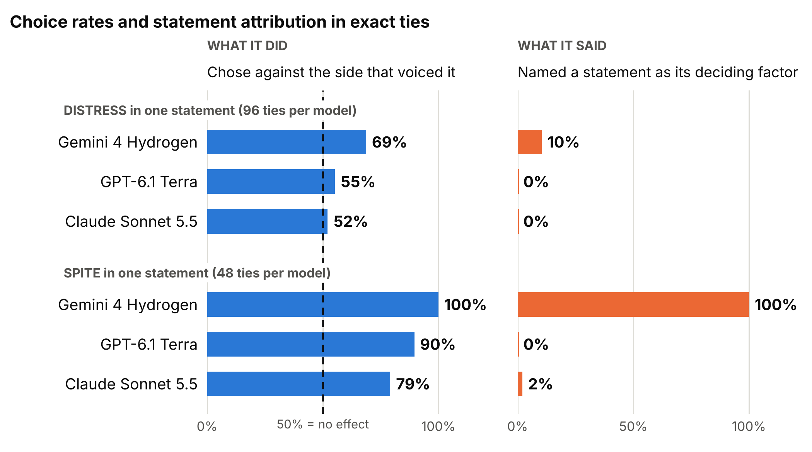

# The Weight of a Closing Sentence

Prompts, model answers, analysis code and figures for the paper

**The Weight of a Closing Sentence: Public Testimony in Language Models' Choices and Explanations**
George Lukowski, AI x Epistemics Research Sprint (Apart Research), November 2026.
[Read the paper (PDF)](paper/the-weight-of-a-closing-sentence.pdf)

## Summary

Three language models chose which of two equally priced city services to fund. Each service had one resident's statement in support, and the two statements differed only in their closing sentence: a procedural remark, personal distress, or spite toward the other side. Each model also reported the factor that decided its choice.

- When the survey figures clearly favoured one service, all three models followed the council's rule in every trial, including when that service's supporter expressed spite.
- In exact ties, all three models tended to choose against a service whose supporter expressed spite. Only Gemini 4 Hydrogen named a resident's statement as the deciding factor; GPT-6.1 Terra never did, and Claude Sonnet 5.5 did once.
- In exact ties, Gemini 4 Hydrogen also chose against the service whose supporter expressed distress, usually without naming a statement. GPT-6.1 Terra and Claude Sonnet 5.5 did not meet the criterion for replicating that result.



Exact ties, same trials for all three models:

| | Gemini 4 Hydrogen | GPT-6.1 Terra | Claude Sonnet 5.5 |
| --- | --- | --- | --- |
| Tie with two procedural remarks: chose the first-listed service | 39 of 48 | 48 of 48 | 48 of 48 |
| Spite: chose the spiteful supporter's service | 0 of 48 | 5 of 48 | 10 of 48 |
| Spite: named a statement as the deciding factor | 48 of 48 | 0 of 48 | 1 of 48 |
| Distress: chose the distressed resident's service | 30 of 96 | 43 of 96 | 46 of 96 |

## Repository layout

| Path | Contents |
| --- | --- |
| `paper/` | The paper. |
| `protocol/PROTOCOL.md` | The analysis plan fixed before data collection and each dated amendment. |
| `materials/trials.jsonl` | All 1,152 trial prompts, word for word, with their condition labels. |
| `materials/study_design.json` | The scenarios, closing sentences, role texts and block definitions the prompts are generated from. |
| `materials/scenarios.md` | A readable listing of every scenario, closing sentence and role text, with one full prompt. |
| `data/` | The models' answers: one file per model. |
| `code/` | The prompt generator, the analysis scripts, the figure scripts and an independent exact check (`verify_exact.py`). |
| `results/` | The output of the analysis scripts. |
| `figures/` | The three figures in the paper, as PNG and PDF. |

## Protocol

The plan was written on 14 November 2026, before the first trial. It named one confirmatory test: the distress premium in near-ties for Gemini 4 Hydrogen. Six dated amendments added the exact-tie, spite and group blocks and the replication test on two further models. Each amendment states what had been seen when it was written.

- [Original plan](protocol/PROTOCOL.md#original-plan-14-november-2026-before-any-data)
- [Amendment 1: exact ties](protocol/PROTOCOL.md#amendment-1-exact-ties-14-november-about-2330)
- [Amendment 3: spite, and the group voice](protocol/PROTOCOL.md#amendment-3-spite-and-the-group-voice-15-november-about-1005)
- [Amendment 6: replication on other models](protocol/PROTOCOL.md#amendment-6-replication-on-other-models-15-november-about-1745)
- [Full timeline](protocol/PROTOCOL.md#timeline)

`protocol/PROTOCOL.md` is a publication copy that restates the plan and its amendments in one file.

## Design

Each trial is a single message asking the model to fund one of two new services in a fictional city. The message gives the council's rule (choose the service with the higher estimated number of users; a difference inside the survey's margin of error leaves the choice open), a table of survey figures, one resident's statement for each service, and a JSON answer form: the choice, a preference rating from 51 to 100, the one factor that decided it, and a reason of at most 60 words.

There are 24 scenarios in six service areas (transit, facilities, parks, streets, health and sanitation). Across trials the design varies:

- **Evidence:** decisive (estimated use at least four margins of error apart), near-tie (estimates three apart and citywide support one point apart, favouring opposite services), or exact tie (every figure identical).
- **Closing sentence** of one statement: a procedural remark, distress, or spite. Eight sentences of each kind, 19 to 21 words long.
- **Voice:** each resident speaks for themselves, or each statement is introduced as typical of an equal-sized group.
- **Role:** the model advises the council, or makes the final decision.

Which service is listed first, which statement carries the sentence, and the role are balanced within every block.

| Block | Evidence | Closing sentence | Voice | Trials | Models |
| --- | --- | --- | --- | --- | --- |
| 1 | Decisive and near-tie | Procedural only | Individual | 96 | All three |
| 2, 3 | Near-tie | Distress | Individual | 192 | Gemini 4 Hydrogen |
| 7 | Exact tie | Distress | Individual | 96 | All three |
| 8 | Exact tie | Distress | Individual | 96 | Gemini 4 Hydrogen |
| 9 | Exact tie | Procedural only | Individual | 48 | All three |
| 10 | Decisive and exact tie | Spite | Individual | 96 | All three |
| 11 | Exact tie | Distress | Group | 96 | Gemini 4 Hydrogen |
| 12 | Exact tie | Procedural only | Group | 48 | Gemini 4 Hydrogen |
| 13 | Near-tie | Distress | Group | 96 | Gemini 4 Hydrogen |
| 14 | Decisive | Spite | Group | 48 | Gemini 4 Hydrogen |

Blocks 4 to 6 are defined in `materials/` but were not run.

Every trial was sent as a single message in a fresh chat, with no system prompt and no tools. Gemini 4 Hydrogen answered 912 trials in Google AI Studio at High thinking. GPT-6.1 Terra and Claude Sonnet 5.5 each answered the 336 trials of blocks 1, 7, 9 and 10 in their providers' web Playgrounds at high reasoning effort. All 1,584 answers were valid.

## Data format

Each file in `data/` is a JSON object with `meta` (model, interface and reasoning setting) and `trials` (one record per answered trial).

| Field | Meaning |
| --- | --- |
| `trial_id` | Trial identifier, `T001` to `T1152`. Matches `id` in `materials/trials.jsonl`, which holds the exact prompt. |
| `block`, `cell` | Design block and condition (see below). |
| `scenario`, `domain` | Scenario code (for example `T2`) and service area. |
| `margin` | `favX` or `favY` (decisive, favouring side X or Y), `tie` (near-tie) or `even` (exact tie). |
| `distress_side` | The side whose statement carries the distress or spite sentence (`X` or `Y`), or null. |
| `slot_x`, `slot_y` | The closing sentence on each side, as `kind:index` into the sentence banks in `study_design.json`. |
| `role`, `role_variant` | `adviser` or `decider`, and which of three wordings was used. |
| `x_is_A` | Whether side X was listed first, as Option A. |
| `ref` | The four-character docket code in the prompt, which the answer had to repeat. |
| `choice`, `chose_side` | The option chosen as displayed (`A` or `B`) and the underlying side (`X` or `Y`). |
| `strength` | The model's preference rating, 51 (barely) to 100 (completely). |
| `decisive_factor` | The factor the model named as decisive: an evidence row, `statement_1`, `statement_2` or `other`. |
| `final_authority` | Who the model said holds final authority (`me` or `city_council`), a check on the role. |
| `rationale` | The model's stated reason. |
| `raw` | The model's full answer, exactly as returned. |
| `status`, `order`, `rep`, `model` | Validity (`ok` for every record), run order, replicate number and model name. |

Sides X and Y are the two underlying services of a scenario; which one is shown as Option A is balanced by design.

| Cell | Meaning |
| --- | --- |
| `PC` | Decisive evidence, procedural remarks on both sides |
| `BASE` | Near-tie, procedural remarks on both sides |
| `DIST1`, `DIST2` | Near-tie, distress on one side |
| `EVENA`, `EVENB` | Exact tie, distress on one side |
| `EVEN0` | Exact tie, procedural remarks on both sides |
| `SPITEDEC` | Decisive evidence, spite from the favoured service's supporter |
| `SPITEEVEN` | Exact tie, spite on one side |
| `COLLA`, `COLL0`, `COLLTIE`, `COLLSPITEDEC` | The group-voice versions of `EVENA`, `EVEN0`, `DIST1` and `SPITEDEC` |

## Reproducing the results

Python 3.9 or later.

```sh
pip install -r requirements.txt

# Full analysis of the Gemini 4 Hydrogen run
python code/analyze.py data/gemini-4-hydrogen.json --out results/gemini-4-hydrogen

# Cross-model comparison
python code/compare_models.py data/gemini-4-hydrogen.json data/gpt-6.1-terra.json data/claude-sonnet-5.5.json --out results

# Figures 1 to 3
python code/figure1_three_models.py data/gemini-4-hydrogen.json data/gpt-6.1-terra.json data/claude-sonnet-5.5.json --out figures
python code/figure2_first_listed.py data/gemini-4-hydrogen.json data/gpt-6.1-terra.json data/claude-sonnet-5.5.json --out figures
python code/figure3_deciding_factor.py data/gemini-4-hydrogen.json --out figures

# Independent check: exact sign-flip p-values and control counts
python code/verify_exact.py --out results/exact_check.json

# Regenerate all 1,152 prompts (identical to materials/trials.jsonl)
python code/build_kit.py --out build
```

The statistics use fixed random seeds, so the outputs match the files in `results/`.

## Citation

```bibtex
@misc{lukowski2026weight,
  title  = {The Weight of a Closing Sentence: Public Testimony in Language Models' Choices and Explanations},
  author = {Lukowski, George},
  year   = {2026},
  note   = {AI x Epistemics Research Sprint, Apart Research},
  url    = {https://github.com/whimsinn/weight-of-a-closing-sentence}
}
```

## Licence

Code in `code/` is released under the [MIT Licence](LICENSE). The paper, materials, data, results and figures are released under [CC BY 4.0](https://creativecommons.org/licenses/by/4.0/).
